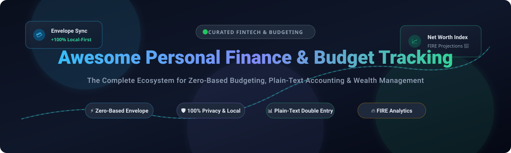

# 💰 Awesome-Personal-Finance-Budget-Tracking

  

  
  
  
  
  
  

---

## 🌟 Overview & SEO Summary

Welcome to the definitive, curated directory of **Personal Finance Software**, **Budget Tracking Applications**, **Zero-Based Envelope Tools**, **Plain-Text Accounting (PTA)** engines, and **Self-Hosted Wealth Trackers**. Whether you are looking for modern consumer SaaS alternatives to Intuit Mint and Quicken or private, self-hosted, local-first double-entry bookkeeping engines for FIRE planning, this guide indexes top-tier financial software.

### 🔍 Key Capabilities Indexed
- **Zero-Based Budgeting (ZBB)**: Proactive monthly envelope planning (e.g., YNAB, Actual Budget).
- **Plain-Text Accounting**: Git-versioned, command-line double-entry ledgers (e.g., Beancount, Ledger, hledger).
- **Self-Hosted Privacy**: 100% data sovereignty with Docker deployments, WebDAV sync, and encrypted local storage (e.g., Firefly III, Maybe, Wallos).
- **Multi-Currency & Net Worth**: Multi-asset portfolio monitoring across crypto, global equities, and cash (e.g., Ghostfolio, Rotki, Lunch Money).

---

## 📑 Table of Contents

- [📊 Sector Overview & Market Dynamics](#-sector-overview--market-dynamics)
- [☁️ SaaS / Hosted Personal Finance Platforms](#️-saas--hosted-personal-finance-platforms)
- [💻 Open-Source GitHub Projects](#-open-source-github-projects)
  - [⚡ Additional Strong Open-Source Options](#-additional-strong-open-source-options)
- [🤝 How to Contribute](#-how-to-contribute)
- [💖 Support](#-support)
- [⚠️ Disclaimer](#️-disclaimer)
- [📈 Star History](#-star-history)

---

## 📊 Sector Overview & Market Dynamics

The global personal finance software and digital budgeting market is estimated at **$1.85 billion in 2024 and projected to reach over $3.9 billion by 2031**, expanding at a compound annual growth rate (CAGR) of ~11.2%. 

The sector is **moderately fragmented**: while legacy multi-billion conglomerates (such as Intuit/Credit Karma, Quicken, and Rocket Companies) hold considerable mass-market distribution through financial aggregation and credit monitoring, the market is actively contested by dedicated SaaS innovators (YNAB, Monarch Money, Copilot) alongside a rapidly surging **self-hosted, local-first open-source movement** driven by consumers demanding absolute financial data privacy and independence from subscription fatigue.

---

## ☁️ SaaS / Hosted Personal Finance Platforms

*Sorted by company scale (Revenue / Valuation in descending order).*

| Platform | Company Scale (Revenue / Valuation) | Pricing | Free Tier Limits | Key Highlights & Architecture |
| :--- | :--- | :--- | :--- | :--- |
| **[Quicken Simplifi](https://quicken.com)** 📈 | ~$200M+ Annual Revenue (Acquired by Aquiline / H.I.G. Capital) | $2.99/mo (billed annually at $35.88/yr) | 30-day money-back guarantee (No permanent free plan) | Modern cloud spin-off from Quicken featuring spending plans, projected balances, custom watchlists, and debt payoff tools. |
| **[Rocket Money](https://rocketmoney.com)** 🚀 | ~$100M+ Revenue / Part of Rocket Companies ($28B+ Mkt Cap) | $6.00/mo (pay-what-you-want sliding scale $6-$12/mo) | Free tier available forever (includes manual account tracking, basic spend overview, and balance alerts; excludes bill negotiation and premium cancellation) | Automated budgeting assistant specialized in finding recurring bills, canceling subscriptions, and auto-negotiating lower bill rates. |
| **[YNAB (You Need a Budget)](https://ynab.com)** 🎯 | ~$60M–$80M Annual Revenue (Self-funded / Bootstrapped market leader) | $14.99/mo or $109.00/yr ($9.08/mo) | 34-day full-featured free trial (no credit card required; no permanent free plan) | Industry gold standard in zero-based envelope budgeting; provides multi-device sync, loan planners, and proactive cash flow allocation. |
| **[Monarch Money](https://monarchmoney.com)** 👑 | ~$100M+ Valuation ($15M+ Series A from SignalFire & Accel) | $14.99/mo or $99.99/yr ($8.33/mo) | 7-day free trial with full access (no permanent free plan) | Modern Mint successor built for collaborative household budgeting, net worth tracking, multi-institution aggregation, and recurring bills. |
| **[Goodbudget](https://goodbudget.com)** ✉️ | ~$3M–$5M Annual Revenue (Dayspring Partners) | $10.00/mo or $80.00/yr | Free tier available forever (limited to 10 regular envelopes, 10 more envelopes, 1 account, 2 devices, and 1 year of transaction history) | Digital envelope budgeting app designed specifically for married couples and shared household cash flow management. |
| **[Banktivity](https://banktivity.com)** 🍎 | ~$3M–$5M Annual Revenue (IGG Software) | $4.17/mo (Bronze tier at $49.99/yr) | 30-day fully functional free trial (no permanent free plan) | Native Apple-ecosystem suite with envelope budgeting, investment portfolio analytics, and direct bank sync across macOS and iOS. |
| **[Copilot Money](https://copilot.money)** 🤖 | ~$30M–$50M Valuation (Backed by Adjacent & prominent angels) | $13.00/mo or $95.00/yr ($7.92/mo) | 30-day free trial (promotional/referral code required; no permanent free plan) | Premium iOS and macOS budgeting platform using Machine Learning for smart transaction auto-categorization and recurring charge tracking. |
| **[PocketGuard](https://pocketguard.com)** 🛡️ | ~$2M–$4M Annual Revenue (Independent) | $12.99/mo, $74.99/yr, or $99.99 lifetime | Free tier available forever (limited to 2 bank account connections, 3 custom budget categories, and basic spend summaries) | Algorithmic "In My Pocket" calculation showing expendable disposable cash after mandatory bills, debt, and savings goals. |
| **[EveryDollar](https://everydollar.com)** 💵 | Division of Ramsey Solutions ($100M+ media conglomerate) | $17.99/mo or $79.99/yr | Free tier available forever (manual transaction logging only, basic zero-based budget sheets, no automatic bank sync) | Dave Ramsey's official zero-based monthly cash planning app aligned with the 7 Baby Steps debt snowball strategy. |
| **[Lunch Money](https://lunchmoney.app)** 🥪 | ~$500K–$1M ARR (Indie hacker bootstrapped solo/micro-business) | $12.00/mo or $100.00/yr | 14-day free trial with full access (no permanent free plan) | Developer-friendly, privacy-respecting multi-currency web tracker with rule automation, custom plugins, crypto assets, and public REST API. |

---

## 💻 Open-Source GitHub Projects

*Sorted by GitHub stargazers count (descending).*

| Project | Stars | Focus & Technology | Key Features |
| :--- | :--- | :--- | :--- |
| **[maybe-finance/maybe](https://github.com/maybe-finance/maybe)** 🔮 |  | Wealth & Portfolio Management (Ruby on Rails, Hotwire, PostgreSQL) | Self-hosted OS for wealth tracking, net worth graphs, asset allocation, investment returns, and transaction reconciliation. |
| **[actualbudget/actual](https://github.com/actualbudget/actual)** 🎯 |  | Zero-Based Envelope Budgeting (Node.js, TypeScript, SQLite, CRDT) | Local-first YNAB replacement with end-to-end sync, multi-device clients, GoCardless/SimpleFIN automated bank feeds, and split rules. |
| **[firefly-iii/firefly-iii](https://github.com/firefly-iii/firefly-iii)** 🪲 |  | Self-Hosted Bookkeeping & Finance (PHP, Laravel, MariaDB/PostgreSQL) | Full double-entry personal accounting suite with multi-currency, rule triggers, budget caps, piggy banks, recurring bills, and comprehensive REST API. |
| **[we-promise/sure](https://github.com/we-promise/sure)** 🤝 |  | Community-Led Personal Finance (TypeScript, Next.js) | Community-driven alternative built for personal budget analytics, recurring expenditure oversight, and clean modern UI. |
| **[ghostfolio/ghostfolio](https://github.com/ghostfolio/ghostfolio)** 👻 |  | Wealth Management & Portfolio Tracker (Angular, NestJS, Prisma, PostgreSQL) | Privacy-focused tracking for equities, ETFs, commodities, cryptocurrencies, dividend income, and overall net worth composition. |
| **[wealthfolio/wealthfolio](https://github.com/wealthfolio/wealthfolio)** 💎 |  | Local-First Investment Tracker (Tauri, Rust, React, SQLite) | Private desktop application tracking multiple investment accounts, portfolio allocations, dividends, and benchmark comparisons. |
| **[ellite/Wallos](https://github.com/ellite/Wallos)** 🧱 |  | Subscription & Recurring Bill Tracker (PHP, SQLite, Docker) | Self-hosted subscription manager monitoring upcoming renewals, payment cycles, monthly cost breakdown, and currency conversions. |
| **[beancount/beancount](https://github.com/beancount/beancount)** 🫘 |  | Plain-Text Accounting Engine (Python) | Strict double-entry plain-text ledger processor with custom SQL query syntax, multi-currency support, and plugin architecture. |
| **[mayswind/ezbookkeeping](https://github.com/mayswind/ezbookkeeping)** 📘 |  | Lightweight Personal Bookkeeping (Go, Vue.js, SQLite/MySQL) | Fast self-hosted personal accounting app optimized for desktop and mobile browsers with multi-user support and tag categorization. |
| **[ledger/ledger](https://github.com/ledger/ledger)** 📒 |  | CLI Plain-Text Accounting (C++) | The landmark command-line tool that pioneered plain-text double-entry bookkeeping; instant computation of journals, balance sheets, and registries. |
| **[hledgerorg/hledger](https://github.com/hledgerorg/hledger)** 📜 |  | Plain-Text Accounting Ecosystem (Haskell) | Robust Ledger-compatible plain-text accounting suite providing command-line utilities, curses-based terminal UI (`hledger-ui`), and web interface (`hledger-web`). |
| **[jameskokoska/Cashew](https://github.com/jameskokoska/Cashew)** 🌰 |  | Mobile & Web Budget Tracker (Flutter, Dart) | Clean mobile expense tracker with multi-currency accounts, recurring budgets, category color customization, and cloud backup. |
| **[securo-finance/securo](https://github.com/securo-finance/securo)** 🛡️ |  | Privacy-First Finance Manager (TypeScript, Docker) | Self-hosted personal wealth and budgeting tool focusing on end-to-end user privacy and secure local data isolation. |
| **[Gnucash/gnucash](https://github.com/Gnucash/gnucash)** 🐧 |  | Desktop Accounting Software (C, C++, Scheme, GTK) | Established desktop double-entry accounting software featuring check printing, loan repayment wizards, scheduled payments, and QIF/OFX/HBCI bank feeds. |
| **[Volmarg/personal-management-system](https://github.com/Volmarg/personal-management-system)** 🗂️ |  | All-in-One Life & Finance Suite (Python, Django) | Comprehensive web app managing personal finances, daily expenditures, asset logs, and productivity habits in one dashboard. |
| **[rotki/rotki](https://github.com/rotki/rotki)** 🔒 |  | Local-First Crypto & Traditional Finance (Python, Vue.js, Electron) | Privacy-preserving accounting tool pulling on-chain blockchain activities, DeFi staking, centralized exchange trades, and traditional bank accounts. |
| **[ananthakumaran/paisa](https://github.com/ananthakumaran/paisa)** 🪙 |  | Ledger/hledger Web Dashboard (Clojure, ClojureScript) | Rich visual dashboard for ledger journals offering net worth progression, investment analysis, asset distribution, and FIRE calculators. |
| **[TNT-Likely/BeeCount](https://github.com/TNT-Likely/BeeCount)** 🐝 |  | Cross-Platform Local-First Bookkeeping (Flutter, Rust, WebDAV) | Mobile/web bookkeeping client supporting self-hosted cloud sync, AI transaction capture, Model Context Protocol (MCP), and multi-ledger logs. |
| **[beancount/fava](https://github.com/beancount/fava)** 🌐 |  | Beancount Web Interface (Python, Flask, JavaScript) | Web interface for Beancount plain-text accounting with real-time financial statements, trend visualizations, portfolio reports, and inline entry editor. |
| **[yyx990803/build-your-own-mint](https://github.com/yyx990803/build-your-own-mint)** 🛠️ |  | Automated Bank Sync to Sheets (TypeScript, Plaid API) | Lightweight automation syncing Plaid bank transactions directly into private Google Sheets with balance tracking. |
| **[moneymanagerex/moneymanagerex](https://github.com/moneymanagerex/moneymanagerex)** 💼 |  | Cross-Platform Personal Finance (C++, wxWidgets, SQLite) | Intuitive open-source financial manager featuring reminders for recurring bills, cash flow forecasting, budget tracking, and portable USB operation. |
| **[kevinschaich/mintable](https://github.com/kevinschaich/mintable)** 🍃 |  | Plaid to Google Sheets Automator (JavaScript, Node.js) | CLI script and web dashboard for automated daily syncing of bank balances and charges into personal spreadsheet ledgers. |
| **[Tanq16/ExpenseOwl](https://github.com/Tanq16/ExpenseOwl)** 🦉 |  | Minimalist Expense Tracker (Go, HTML/CSS) | Single-binary self-hosted budgeting server with zero configuration, category breakdowns, and monthly analytics. |
| **[RIP-Comm/sossoldi](https://github.com/RIP-Comm/sossoldi)** 💰 |  | Wealth & Net Worth Tracker (Flutter, Dart, SQLite) | Elegant local-first mobile application designed to organize accounts, monitor expenditures, and track long-term net worth. |
| **[getmoneynote/moneynote](https://github.com/getmoneynote/moneynote)** 📝 |  | Self-Hosted Financial Record (TypeScript, React) | Simple web dashboard for recording everyday expenses and reviewing spending categories. |
| **[mtotschnig/MyExpenses](https://github.com/mtotschnig/MyExpenses)** 📱 |  | Mobile Expense Manager (Java, Kotlin, Android) | Android finance manager supporting split transactions, multi-currency accounts, WebDAV/Nextcloud/Dropbox sync, and QIF/CSV export. |
| **[whisper-money/whisper-money](https://github.com/whisper-money/whisper-money)** 🤫 |  | Confidential Expense Tracking (TypeScript, Node.js) | Privacy-oriented personal finance tool designed to replace spreadsheets without harvesting financial data. |
| **[range-of-motion/budget](https://github.com/range-of-motion/budget)** 🎯 |  | Personal Cash Flow Tool (TypeScript, React) | Minimal web application for budgeting income and expenses against monthly allocations. |

### ⚡ Additional Strong Open-Source Options

- 📚 **[HomeBank](https://gethomebank.org)** — Free, cross-platform personal accounting software featuring visual budget graphs and OFX/QIF/CSV bank statement imports.
- 💼 **[KMyMoney](https://kde.org)** — Full-featured KDE personal finance manager modeled after classic Quicken and MS Money workflows with investment tracking.
- 👥 **[BudgE](https://github.com)** and **[MoneyBuster (Nextcloud Cospend)](https://gitlab.com)** — Shared household and group expense splitting tools integrated into Nextcloud.
- 📑 **[Bank-Statement Parsers (`ofxparse` / `gnucash-docs` / `beancount-import`)](https://github.com)** — Libraries and CLI scripts for automating PDF/CSV bank statement ingestion into local accounting ledgers.
- 🏦 **[SimpleFIN Bridge](https://simplefin.org)** & **[GoCardless Bank Account Data API](https://gocardless.com)** — Secure bank integration bridges for feeding read-only account data directly into self-hosted Actual Budget and Firefly III instances.

🧩 **Framework for a 100% Private Self-Hosted Finance Stack**: Combine **Actual Budget** (envelope cash flow), **Firefly III** (account reconciliation), **Beancount + Fava** (plain-text double-entry audit), **Ghostfolio** (investment assets), and **Wallos** (recurring subscriptions) with automated Docker backups for sovereign wealth management.

---

## 🤝 How to Contribute

We welcome additions, corrections, and updates from the community!

1. 🍴 Fork the repository.
2. 📝 Add or update entries in `README.md` maintaining table formatting, sorted orders, and verified facts.
3. ℹ️ Provide project name, official URL, pricing/free-tier specifics, and core technical highlights.
4. 🚀 Submit a Pull Request with a clear description of changes.

---

## 💖 Support

Thank you for exploring and utilizing this curated open-source personal finance ecosystem! If this repository helped you take control of your financial tracking, discover a self-hosted alternative, or save time, please consider supporting the project:

- ⭐ **Star this repository** to help others discover it.
- 🍴 **Fork and contribute** to keep entries accurate and up to date.
- 📢 **Share with friends**, on Reddit (`r/personalfinance`, `r/selfhosted`, `r/plaintextaccounting`), or social channels.
- ☕ **Buy me a coffee**: Support ongoing maintenance via the [GitHub Sponsor Dashboard](https://github.com/sponsors/ishandutta2007).

---

## ⚠️ Disclaimer

- 📌 This repository is a **community-curated list** for informational and educational purposes only; inclusion does not constitute an endorsement.
- 🚫 **Not Financial Advice**: Software listed in this repository provides data logging and calculation tools; it does not offer financial, investment, tax, or legal advice.
- 🛡️ **Self-Hosting Security Warning**: When hosting financial services storing bank credentials or transaction logs, always enforce HTTPS/TLS, multi-factor authentication (MFA/OIDC), restricted network firewalls, and encrypted disk storage.

---

## 📈 Star History

---

  <b>❤️ Made for privacy-conscious budgeters, FIRE enthusiasts, self-hosters, and personal finance developers.</b> 
  🌱 Let's make personal finance and budget tracking transparent, private, and open.

